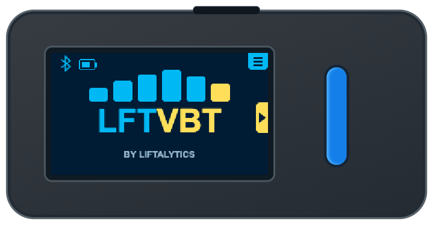

# LFTVBT

[**Explore the interactive device preview →**](https://reposandreps.github.io/LFTVBT/)

## Making velocity-based training more accessible and convenient

Velocity-based training (VBT) is a pretty cool tool to have in your training toolbox.

We already track how much weight we lift and how many reps we do, but there's another useful metric that's often missing: **how fast those reps move**.

Bar velocity gives us another objective way to track progress and performance. It can also help estimate relative intensity (%1RM) and inform how we think about RPE and reps in reserve (RIR).

There are plenty of ways to measure bar speed, from linear position transducers (LPTs) to camera apps and inertial measurement units (IMUs). The problem is that you often have to make a trade-off between **accuracy, affordability, and convenience**.

High-quality LPTs can be accurate, but they're expensive and the tether can get in the way of training. Camera apps can also work well, but they may need a specific filming setup and some require processing each video. IMU-based devices are convenient, but the options vary considerably in price and accuracy.

There are some great open-source projects out there, too. The catch is that many require technical expertise and building the device yourself.

**That's something I hope to change with LFTVBT.**

The idea is to take a readily available development kit costing around **US$20** and turn it into an accurate, convenient device that you can attach to the bar and get on with training.

The proposed setup uses the **BMI270 accelerometer and gyroscope inside the M5StickS3**, with motion data sent over Bluetooth to your phone.

The goal is to make measuring, tracking, and using bar speed as straightforward as possible:

**Order an M5StickS3 → Load the firmware → Connect the app → Start tracking**

That's the aim, not a finished setup you can download and use just yet.

## Hardware and mounting options

If you'd like to see what I'm working with, here are the M5Stack parts I'm exploring:

- [**M5StickS3 ESP32-S3 Mini IoT Dev Kit**](https://shop.m5stack.com/products/m5sticks3-esp32s3-mini-iot-dev-kit) — the proposed device core.
- [**Watch Accessory Kit for M5Stick series**](https://shop.m5stack.com/products/watch-accessory-kit-for-m5stick-series) — a possible attachment option.
- [**M5Stack Clip-A Brick Kit**](https://shop.m5stack.com/products/m5stack-clip-a-brick-kit?variant=45762860155137) — another mounting accessory to explore.

These are links to the parts, **not a validated assembly guide**. Fit, retention on a moving barbell, and the final mounting arrangement still need testing.

## What I'm working towards

- **Compact, bar-mounted hardware.** A lightweight device that attaches directly to the barbell without getting in the way or adding manual processing between sets.
- **Accuracy where it counts.** Getting perfect velocity measurements from an IMU is tricky. My priority is to develop and validate useful **mean concentric velocity** measurements, one of the most important metrics for many strength-training applications.
- **Bluetooth connectivity.** Sending motion data to a phone for storage, export, and potentially further analysis, depending on what processing can happen directly on the device.
- **Support for different lifts.** I'll focus initially on squats, bench presses, and deadlifts. If those work well, I'd like to expand to more exercises and offer a general-purpose mode, with the caveat that accuracy may be lower for movements that haven't been tested.
- **A simple interface.** Quick calibration, clear velocity readouts, battery and connection status, and minimal fuss between sets.

## Explore the interface

The first interactive UI/UX concept is available to try in your browser.

[**Launch the LFTVBT interactive preview →**](https://reposandreps.github.io/LFTVBT/)

This is just a mock-up (which I got a little carried away with because I like UI stuff 👀), but I think it'll be close to the final interface once I get the technical side working.

The preview is designed around the M5StickS3's **240 × 135 display** and physical buttons. Measurements, calibration, and other device states are simulated for now.

## Early stages, big ambitions

LFTVBT is still an experimental development project.

The exact performance, features, and integrations are still to be figured out. There's no product release or availability date yet.

I'll probably start with Android because iOS likes to make things harder.

For now, this repository is a place to share the idea, gauge interest, and show how the project develops.

At some point, I'll probably need a bigger pool of lifting data to help test and validate the system. If you're interested in getting involved, **get in touch** and I can explain what data collection might involve.

**Follow along as LFTVBT takes shape.**